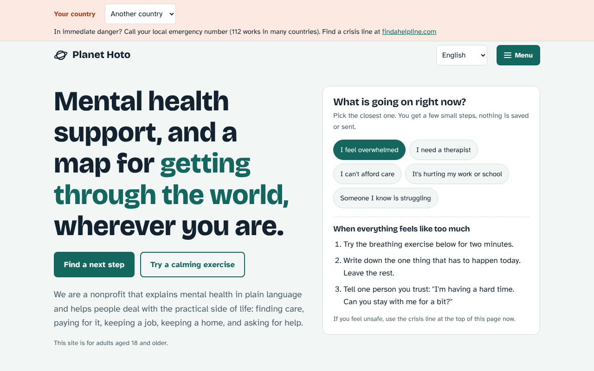
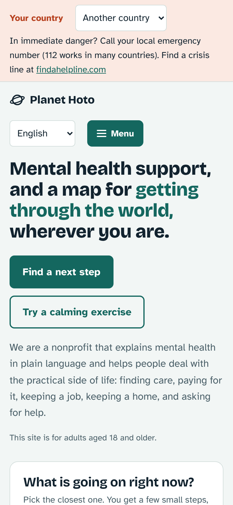

<div align="center">

# 🪐 Planet Hoto

**Plain-language mental health help, for the practical side of life.**

Finding care, paying for it, keeping a job, keeping a home, and asking for help.
Seven languages. No accounts, no tracking, nothing saved or sent.

[**Visit the site → hoto.lol**](https://hoto.lol) · [Contribute](CONTRIBUTING.md) · [Report a problem](https://github.com/hoto1000/planet-hoto/issues/new/choose)



</div>

## Why this exists

Feeling better often depends on boring logistics: which kind of professional to call, what to say on the first call, how to ask for a lower rate, how to write the email to your boss when you can't write the email. Most mental health sites stop at "talk to someone." Planet Hoto tries to cover the next ten steps.

## What's on the site

- **Crisis strip** at the top of every page, with a country picker and a link to [findahelpline.com](https://findahelpline.com).
- **"What is going on right now?" finder**: pick the closest situation and get a few small, concrete steps.
- **Practical guides** with short sections and copyable scripts: getting care, paying for it, work and school, housing and money, relationships, and judging sources.
- **Grounding and breathing tools** that take under two minutes.
- **Seven languages**: English, Español, Português, Français, Deutsch, हिन्दी, 日本語.
- **Private by design**: a static site with no login, no forms that store data, and no analytics in the repo.
- **Accessible**: Atkinson Hyperlegible type, keyboard focus styles, light and dark themes, and a mobile-first layout.



## Tech

Plain HTML, CSS, and JavaScript in [`docs/`](docs), served by GitHub Pages. No framework, no build step, no dependencies.

- [`docs/index.html`](docs/index.html): home page (all seven languages, crisis strip, finder, guides, grounding tool, contact).
- [`docs/avoid-scientology.html`](docs/avoid-scientology.html): a personal page on recognizing and declining Scientology recruiters and front groups.

### Preview locally

```bash
node serve.js docs 8766
```

Then open http://localhost:8766/.

### Deploy

Push to `main`. GitHub Pages serves from `main` / `docs`, so the site updates a minute or so after each push. The custom domain is set in [`docs/CNAME`](docs/CNAME).

## Contributing

Help is very welcome, especially from people who know a country's health system, speak one of the site's languages, or work in mental health. Good places to start:

- Fix or improve a **translation**.
- Add or correct **crisis lines and local services** for a country.
- Make a guide **clearer or shorter**.
- Improve **accessibility** (screen readers, contrast, keyboard use).

Read [CONTRIBUTING.md](CONTRIBUTING.md), then look for issues labeled [`good first issue`](https://github.com/hoto1000/planet-hoto/labels/good%20first%20issue).

If you like the project, a ⭐ helps other people find it.

## Important

Planet Hoto is information and practical guidance, not medical advice, diagnosis, or treatment. If you are in immediate danger, call your local emergency number (112 works in many countries) or find a crisis line at [findahelpline.com](https://findahelpline.com).
